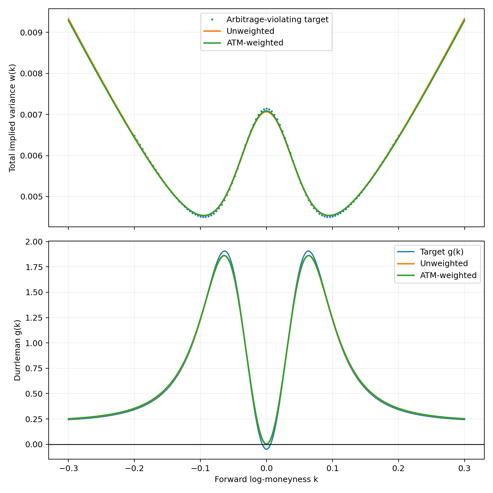
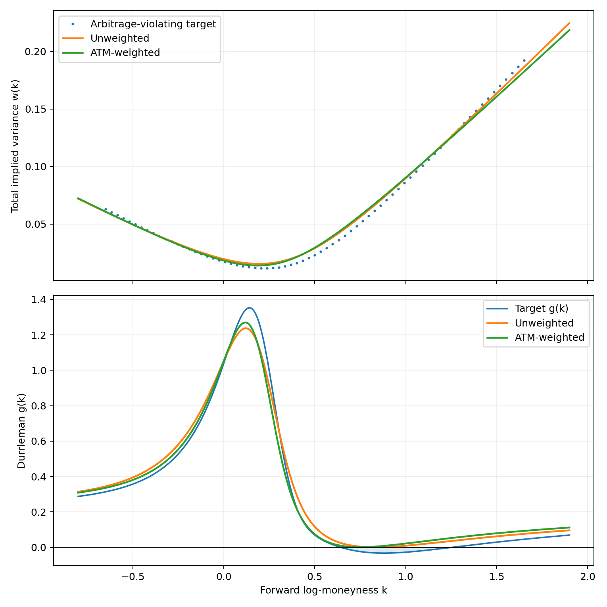

# Direct fitting and no-arbitrage checks for a restricted W-SVI family

**Research discussion note · October 2026**

A coefficient-linear extension of Schadner's conic direct-fit method to a restricted W-shaped quartic, motivated by Clevenger and Wan's WSVI basis. This note reports a preliminary algorithm and synthetic demonstrations, not a proof of globally optimal calibration.

[View the full HTML edition](./index.html) · [Python reproduction script](./svi_wsvi_nobfly.py)

## From the SVI conic to the symmetric WSVI basis

My earlier direct-fit method starts from a geometric fact. With *k* = log(K/F) and *w(k)* = total implied variance, raw SVI is a branch of a conic:

$$
w(k)=a+b\left[\rho(k-m)+\sqrt{(k-m)^2+\sigma^2}\right]
$$

*Raw SVI: total variance as a function of log-moneyness.*

$$
\boxed{F_2(k,w;z)=z_1w^2+z_2kw+z_3k^2+z_4w+z_5k+z_6=0}
$$

*The normalized algebraic-conic representation.*

The conic coefficients enter linearly. Once one coefficient is normalized, the *squared* algebraic fitting criterion is quadratic. An observation-weighting matrix can emphasize at-the-money quotes without changing the algebraic structure:

$$
\boxed{\min_{z_1=1}\; (Dz)^\top SWS(Dz),\qquad W=\mathrm{diag}(\omega_1,\ldots,\omega_n)}
$$

*Weighted conic least-squares objective. The residual normalizer S is held fixed.*

$$
\omega_i=1+\eta\exp\!\left(-\frac{k_i^2}{2h^2}\right),\qquad \eta\ge0,\;h>0.
$$

*One possible ATM emphasis profile.*

Your WSVI construction takes a different starting point, a dimensionless shape family normalized by its ATM variance:

$$
\begin{aligned}w(k)&=\theta f(z),\qquad z=k/\sqrt\theta,\\ f(z)&=\frac{P(z)+\sqrt{P(z)^2+2cz^2}}2,\\ P(z)&=1+sz+\sum_{j=1}^m a_j\varphi_j(z/\lambda_j).\end{aligned}
$$

*Published dimensionless WSVI shape, using the authors’ notation.*

For two order-one members with the same scale and opposite sides, and equal amplitude *α*, the odd components cancel:

$$
\begin{aligned}\varphi_n^{\varepsilon}(u)&=\tfrac12\left[\left(\frac{u^2}{1+u^2}\right)^n+\varepsilon\left(\frac{u}{\sqrt{1+u^2}}\right)^{2n+1}\right],\\ \varphi_1^+(u)+\varphi_1^-(u)&=\frac{u^2}{1+u^2}.\end{aligned}
$$

*The paired order-one basis functions have a rational sum.*

Because the pair sum is rational, the defining WSVI square root can be eliminated and the remaining denominator cleared. This is an **exact identity**, not a polynomial approximation to the smile.

$$
\begin{aligned}0={}&w^2-\theta w-s\sqrt\theta\,kw-\frac{c\theta}2k^2\\&-\theta\alpha\frac{k^2}{k^2+\ell^2}w,\quad \ell^2=\lambda^2\theta.\end{aligned}
$$

*Quadratic identity in the observed total variance, before denominator clearing.*

> Credit and distinction. The W-shaped flexibility and dimensionless basis are from Clevenger and Wan (2026). The quartic representation below is a calibration-oriented reformulation of one symmetric subfamily, not a characterization of the full WSVI model.

## Keep the direct fit, add one quartic shape term

Multiply the ordinary SVI conic by the strictly positive factor *M(k) = k² + ℓ²* and add an interior perturbation. For *ℓ > 0* fixed, this gives

$$
\boxed{F_4(k,w;z,\gamma)=\underbrace{(k^2+\ell^2)}_{M(k)>0}F_2(k,w;z)+\gamma k^2w=0.}
$$

*The proposed coefficient-linear quartic family with fixed effective scale.*

The polynomial is of total degree four in (k,w) but remains quadratic in w. Its seven algebraic coefficients enter linearly in the residual. The design row consists of known functions of observed (k,w):

$$
\boxed{D_{4,i}=\left(M_iw_i^2,\;M_ik_iw_i,\;M_ik_i^2,\;M_iw_i,\;M_ik_i,\;M_i,\;k_i^2w_i\right)}
$$

*Seven observed features per quote; one normalization is imposed on the coefficient vector.*

The symmetric order-one WSVI family is obtained exactly by the following parameter correspondence:

$$
\begin{aligned}M(k)&=k^2+\ell^2,\quad \ell^2=\lambda^2\theta,\\ z_1&=1,\quad z_2=-s\sqrt{\theta},\quad z_3=-\tfrac{c\theta}{2},\\ z_4&=-\theta,\quad z_5=z_6=0,\quad \gamma=-\theta\alpha.\end{aligned}
$$

*Parameter mapping for the symmetric order-one WSVI subfamily.*

For the published Figure 1 values, *σ₀ = 0.60, T = 5/252, s = 0, c = 0.3, α = −0.35, λ = 1*, one obtains *θ = ℓ² = 1/140* and

$$
\boxed{0=(k^2+\theta)\left(w^2-\theta w-0.15\theta k^2\right)+0.35\theta k^2w,\quad\theta=\frac1{140}.}
$$

*Quartic equation for the parameters of the authors’ Figure 1, not for our violating target.*

Clevenger and Wan's own smile at these parameters is already globally free of butterfly arbitrage, with *g(0) = 0.80*. The example used in our calibration experiment below is intentionally different and starts from an arbitrage violation.

### Which part is actually implemented?

The general seven-coefficient quartic is a proposed fitting family. The accompanying Python prototype solves a smaller four-coefficient version, with *q* allowing fitted skew:

$$
F_{4}^{\mathrm{demo}}=(k^2+\ell^2)\big(w^2+qkw+dk^2-\theta w\big)+\gamma k^2w=0.
$$

*Four-coefficient model used in the Python prototype, allowing fitted skew q.*

The target observations are symmetric, so the fitted skew is zero in the reported runs. At *q = 0*, the ATM curvature and butterfly factor have the simple identities

$$
\begin{aligned}F_{4,\mathrm{sym}}&=(k^2+\ell^2)(w^2-\theta w+dk^2)+\gamma k^2w,\\ w^{\prime}(0)&=0,\quad w^{\prime\prime}(0)=-2\left(\frac d\theta+\frac\gamma{\ell^2}\right),\\ g(0)&=1-\frac d\theta-\frac\gamma{\ell^2}.\end{aligned}
$$

*At-the-forward identities for the symmetric special case q = 0.*

The observed data enter only through *k* and *w*. In the fit, *ℓ* is fixed. By contrast, your dimensionless WSVI scales fix *λ*, so the relation *ℓ = λ√θ* varies if θ is estimated. This is the parameterization tradeoff that enables the coefficient-linear fitting objective.

## Fast algebraic fitting, followed by a global sign check

We use the standard Durrleman factor for a positive twice differentiable total-variance slice:

$$
\boxed{g(k)=\left(1-\frac{kw^{\prime}}{2w}\right)^2-\frac{(w^{\prime})^2}{4}\left(\frac1w+\frac14\right)+\frac{w^{\prime\prime}}2\ge0}
$$

*Durrleman’s butterfly-density factor.*

The quintic obtained after implicit differentiation is not a convex constraint on the algebraic coefficients. The proposed algorithm therefore separates **fitting** from **global verification**.

1. Fit algebraically.Minimize the (optionally ATM-weighted) quadratic residual objective, using a fixed effective scale and a coefficient normalization.
2. Apply structural restrictions.Require a positive upper branch, admissible wing behavior, and the intended W-shaped ATM curvature when relevant.
3. Correct locally.Use SLSQP with butterfly inequalities at a small active set of strikes; add new strikes when a global check detects a violation.
4. Certify globally.Eliminate w between the quartic and the numerator of Durrleman's condition. Isolate the resultant's real roots and test the sign on the actual upper branch, including tails.

For ordinary SVI, a rational parameterization gives a degree-at-most-ten polynomial positivity test. For the restricted quartic example, the resultant polynomial has degree 36 in this run. Both are *feasibility oracles*, not closed-form global optimizers.

### Why a polynomial oracle works (implicit differentiation)

For a smooth implicit curve F(k,w(k)) = 0, differentiation gives

$$
\begin{aligned}A&=F_k,\quad B=F_w,\\ w^{\prime}&=-A/B,\\ w^{\prime\prime}&=-\frac{F_{kk}B^2-2F_{kw}AB+F_{ww}A^2}{B^3}.\end{aligned}
$$

*Implicit derivatives for any regular algebraic smile.*

On the positive upper branch, multiplication by the positive denominator gives an equivalent polynomial sign condition:

$$
\boxed{\begin{aligned}G_F={}&16w^2B^3+16kwAB^2+(4k^2-4w-w^2)A^2B\\&-8w^2(F_{kk}B^2-2F_{kw}AB+F_{ww}A^2).\end{aligned}}
$$

*A polynomial sign expression equivalent to g ≥ 0 when w > 0 and Fw > 0.*

Roots of *Resw(F,GF)* are candidate sign-change strikes. They may also originate on a different branch, so the resulting inequality must be evaluated on the fitted upper branch between consecutive roots and at the domain boundaries.

> What the certificate guarantees. Under the program's positive-variance, regular-upper-branch, and strict wing assumptions, the final polynomial test certifies g(k) ≥ 0 globally for the nine-decimal-rounded coefficients. It does not prove that the constrained fit is the globally best approximation.

## Repairing a synthetic, arbitrage-violating W-smile

To test whether the calibration can retain a genuine W shape while enforcing butterfly no-arbitrage, the Python prototype generates **101 noise-free synthetic variance observations** on −0.20 ≤ k ≤ 0.20. The target uses *ℓ² = θ = 1/140* with a deliberately stronger negative interior amplitude than the authors' Figure 1. It has *g(0) = −0.05*, so it violates the butterfly condition.

The weighted run uses the Gaussian ATM profile above with *η = 9* and *h = 0.065*, alongside a comparable unweighted run.

| Metric on synthetic observations | Unweighted | ATM-weighted |
| --- | --- | --- |
| Overall variance RMSE | 0.0000322489 | 0.0000314159 |
| ATM RMSE, \|k\| ≤ 0.05 | 0.0000529880 | 0.0000362749 |
| Active-set correction rounds | 1 | 1 |
| Resultant polynomial degree | 36 | 36 |
| Global butterfly feasibility test | Passed | Passed |

Executed in Python using the companion `svi_wsvi_nobfly.py --model wsvi` program on 27 October 2026. Root isolation used nine-decimal-rationalized fitted coefficients. The values are from one synthetic example, not a performance benchmark against a published fitting algorithm.

### Standard SVI cross-check: Axel Vogt parameters

The same framework is available in ordinary SVI mode. Here the input consists of 71 synthetic observations generated from the conventional Axel Vogt counterexample. The fitted unweighted and ATM-weighted models passed the degree-ten polynomial feasibility test in the executed run.

Run `python svi_wsvi_nobfly.py --model svi` to generate these figures. This experiment is supplementary and separate from the quartic W-SVI result.

## Conic reduction and prospective extensions

### The conic quintic simplifies on the fitted curve

Let A = F2,k and B = F2,w. Then the conic-specific implicit derivatives are

$$
\begin{aligned} A&=F_{2,k}=z_2w+2z_3k+z_5,\\ B&=F_{2,w}=2z_1w+z_2k+z_4,\\ w^{\prime}&=-\frac AB,\qquad w^{\prime\prime}=-\frac{2(z_1A^2-z_2AB+z_3B^2)}{B^3}.\end{aligned}
$$

*Conic-specific implicit derivatives.*

Reducing the Durrleman numerator modulo the conic yields a constant combination in the curvature and a remainder linear in w:

$$
\begin{aligned}J={}&z_5^2-z_2z_4z_5+z_3z_4^2+(z_2^2-4z_3)z_6,\\ A^2-z_2AB+z_3B^2&\equiv J\pmod{F_2},\\ w_+^{\prime\prime}(k)&=-\frac{2J}{\Delta(k)^{3/2}}.\end{aligned}
$$

*The invariant that simplifies curvature on the SVI conic.*

$$
\boxed{G_2(k,w;z)\equiv P(k;z)+Q(k;z)B\pmod{F_2}}
$$

*Polynomial reduction modulo the conic.*

Substitution of the positive upper branch gives P + Q√Δ. The conjugate yields a univariate resultant of degree at most ten, but the correct branch must be retained.

$$
\boxed{N(k;z)=P(k;z)^2-\Delta(k)Q(k;z)^2,\qquad \deg_k N\le10.}
$$

*Univariate resultant for the conic case (with a branch check).*

### Rational SVI parameterization and polynomial positivity

$$
\begin{aligned}k(t)&=m+\frac{\sigma}{2}(t-t^{-1}),\\ w(t)&=a+Ut+Vt^{-1},\qquad t>0,\\ U&=\frac{b\sigma(1+\rho)}2,\qquad V=\frac{b\sigma(1-\rho)}2.\end{aligned}
$$

*Rational parameterization of the upper SVI hyperbola.*

Using *E = 1 + t², Wt = Ut² + at + V, H = mt + σ(t² − 1)/2, R = Ut² − V*, one finds

$$
\boxed{\begin{aligned}\Pi(t)={}&4E(\sigma E W_t-HR)^2\\&-ER^2W_t(W_t+4t)\\&+16(U+V)t^3W_t^2.\end{aligned}}
$$

*Polynomial numerator of the rational SVI butterfly condition.*

$$
\boxed{g(k(t))=\frac{\Pi(t)}{4\sigma^2E(t)^3W_t(t)^2},\quad \Pi(t)\ge0\ \forall t>0.}
$$

*The SVI global sign certificate for positive variance.*

For a positive SVI variance curve, the denominator is positive on t > 0. Nonnegativity of this univariate polynomial is therefore an exact global butterfly test. The identity was checked with SymPy.

### A higher-order sextic proposal (not implemented)

$$
\boxed{F_6=M^2F_2+\gamma_1k^2Mw+\gamma_2k^4w=0,\qquad M=k^2+\ell^2.}
$$

*A further coefficient-linear extension at fixed scale, not implemented.*

The construction is affine in its algebraic coefficients for fixed ℓ, but neither the admissible parameter set nor the cost of a global polynomial certificate has been established for this proposed extension. I did not run this; this is only a hypothesis.

## References and scope of verification

1. Schadner, W. (2024). *Direct Fit for SVI Implied Volatilities*. *The Journal of Derivatives*, 31(3), 38–49. https://doi.org/10.3905/jod.2023.1.199. Source of the conic representation and direct algebraic SVI fitting method.
2. Clevenger, C. and Wan, X. (2026). WSVI: A Dimensionless Shape Family for Implied Volatility and Its Static No-Arbitrage Structure. arXiv:2608.22620.
3. Gatheral, J. and Jacquier, A. (2014). Arbitrage-free SVI volatility surfaces. Quantitative Finance, 14, 59–71.
4. Martini, C. and Mingone, A. (2022). No arbitrage SVI. SIAM Journal on Financial Mathematics, 13, 227–261.

> Verification boundary. Algebraic identities for the SVI conic and its rational polynomial certificate were checked using SymPy. The WSVI–quartic mapping was checked by direct substitution and by numerical evaluation on the symmetric published example. The plotted W-SVI and SVI repairs were rerun from the companion Python program. No global optimality, general WSVI calibration, or speed advantage against an external implementation has been established.

### How to reproduce the figures

`pip install numpy scipy sympy matplotlib
python svi_wsvi_nobfly.py --model wsvi --outdir wsvi_results
python svi_wsvi_nobfly.py --model svi --outdir svi_results`
The companion archive includes `svi_wsvi_nobfly.py`, the symbolic identity-checking script, and the numerical logs. The HTML itself embeds the mathematical SVGs and figures, so it can be viewed without an internet connection.

